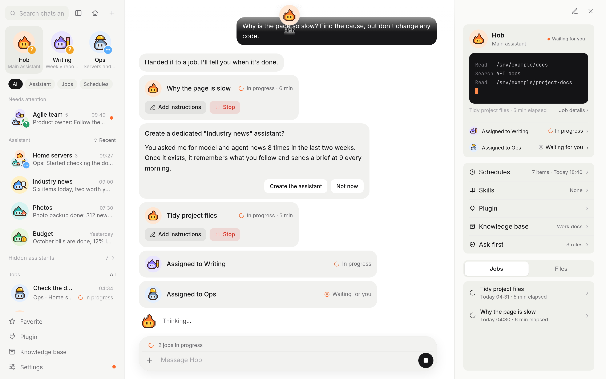
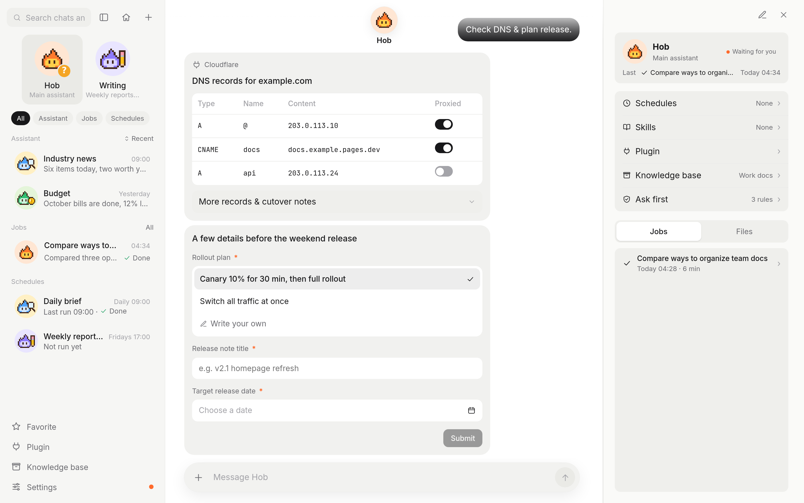
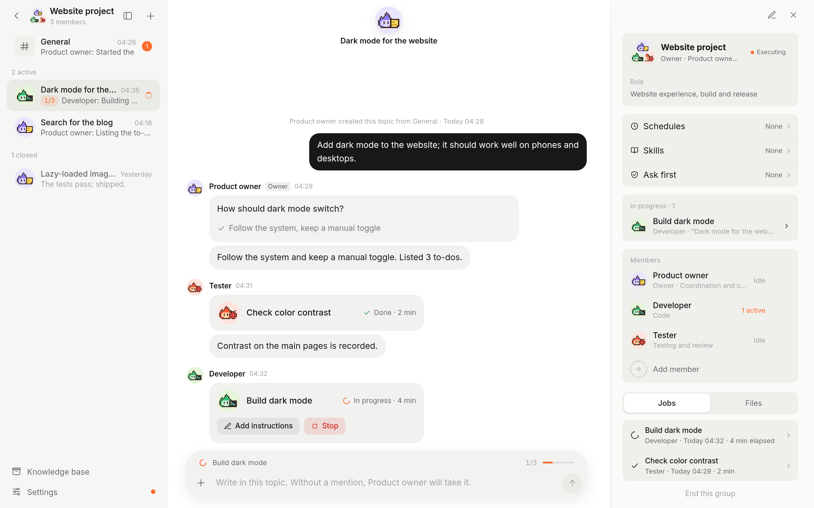
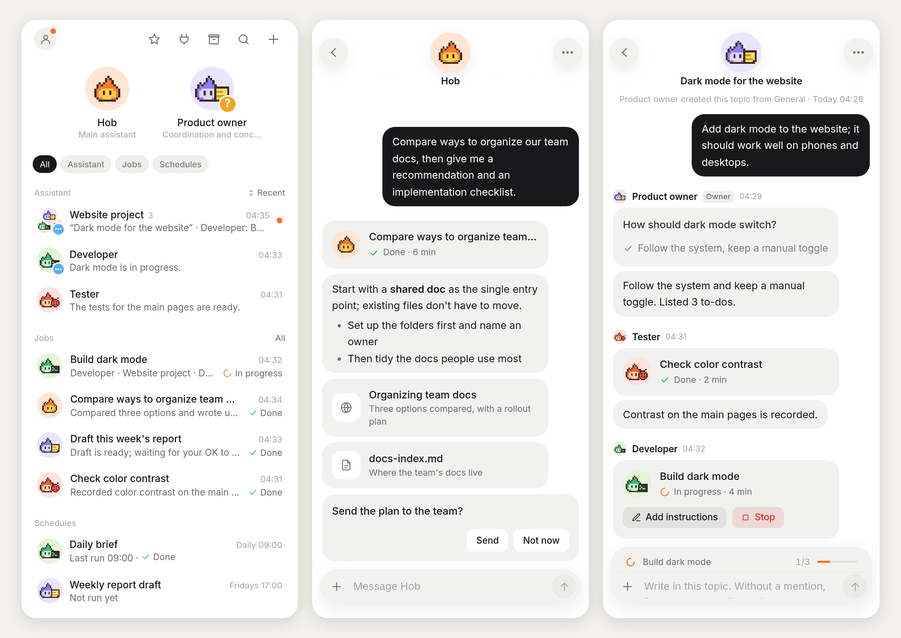
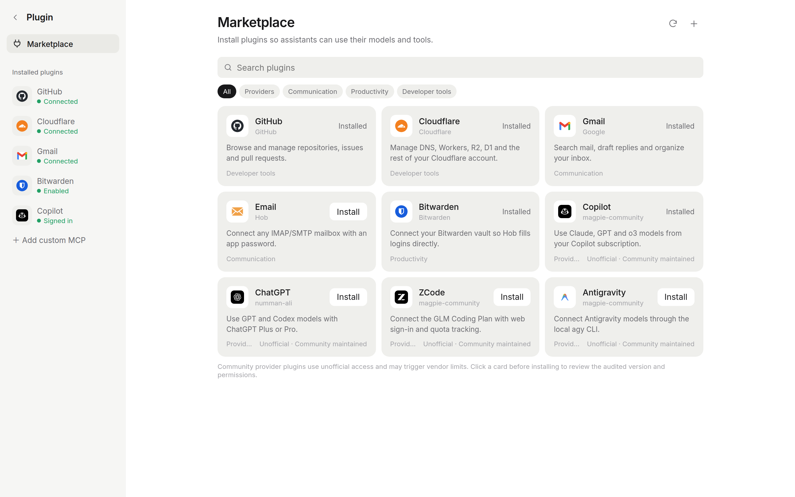

<div align="center">


# Hob

A self-hosted personal assistant. Tell it what you need: it handles small things on the spot,<br>
hands longer work to background jobs, and checks with you when your rules say a decision is yours.

[](https://www.npmjs.com/package/hob-bot)
[](https://github.com/FFatTiger/hob/pkgs/container/hob)

[](LICENSE)

[中文说明](README.zh-CN.md) · [Quick start](#quick-start) · [Deploy](#deploy) · [Architecture](docs/architecture.md)

</div>

> The interface is available in English and Chinese. Hob is a single-user app that runs on your own machine or server with your own model API keys.



## How it works

- **You talk to assistants.** Each assistant has its own duties, rules, skills and schedules. It handles small requests itself and hands longer work to background jobs. A job card shows the live transcript, lets you add instructions or stop the job, and the result comes back into the conversation.
- **Your rules decide what needs your approval.** Global rules and each assistant's own rules say which actions wait for your confirmation and which go ahead. When you confirm something, you can save it as a rule so the same kind of request isn't asked again.
- **Work goes to the right assistant.** Assistants hand requests that belong to another assistant over to it and track them with a delegation card; the result comes back to whoever asked. When similar requests keep coming up, it offers to create a dedicated assistant for them.
- **Schedules wake an assistant only when something changed.** A schedule can carry a check script that runs first; the assistant takes over only when the script finds something new.
- **Finished work becomes a skill.** When an approach is worth keeping, whoever did the work writes it up as a skill: the assistant for what it did itself, or the job when the assistant asks it to review. Assistants and later jobs use it next time, and every change is kept as a new version.

## Cards in the chat

Assistants and plugins can send structured cards right inside a conversation—tables, columns, collapsible details, toggles and forms—so you don't have to copy things back and forth. When an assistant needs your input, it uses a card too, combining multiple-choice questions and fill-in fields (text, numbers, dates and times) so you can answer everything in one go.



## A team of assistants

Put several assistants in a group and they work as a team: the group owner takes messages that don't name anyone (or, if you switch the group to everyone replies, the owner goes first and the other members follow in turn), `@` calls a specific member, and each member can use different models in that group. The owner handles the group's schedules and decides what to do when one fires.

For a larger piece of work, the group owner opens a topic and the team works through it there. When something takes several steps, the assistant keeps a to-do list: each item is just what to do and where it stands, and the assistant updates it as it starts and finishes items, so you can see the progress above the input box and on the job card. Whether to keep a list, and how to split it, is the assistant's judgement. New installations come with an agile team group with product, architecture, development, testing and release members, and a Hacker assistant for security research and reverse engineering, pinned next to Hob.



## On a phone

Hob works in a mobile browser and can be added to the home screen as an app. Push notifications tell you when an assistant needs your answer, finishes its work or fails (HTTPS required).



## Plugin marketplace

Install tool plugins from the marketplace—starting with GitHub, Cloudflare, Gmail, an IMAP/SMTP mailbox and Bitwarden—to give assistants and jobs new tools. Each plugin gets its own settings page, sign-in when needed, per-tool switches and a choice of which assistants may use it. The marketplace also carries community provider plugins (Copilot, ChatGPT, the GLM Coding Plan, Antigravity and OpenCode Zen Free; compatible with OpenCode provider plugins, unofficial integrations) so you can use subscriptions or accounts you already have. Any MCP server can be added as a custom plugin; to host your own source or submit a plugin to the official marketplace, see [hob-plugins](https://github.com/FFatTiger/hob-plugins) and its [contributing guide](https://github.com/FFatTiger/hob-plugins/blob/main/CONTRIBUTING.md).



## Also included

- **Models**: built-in providers such as Anthropic, OpenAI, Google, DeepSeek and OpenRouter only need an API key; any OpenAI- or Anthropic-compatible endpoint works too. npm and source installs can also use your local Claude Code subscription, and provider plugins in the marketplace cover existing subscriptions and accounts.
- **Knowledge bases**: organize and preview files, bind them to assistants and follow citations back to the source; with an embedding model you get hybrid search, including PDF text.
- **Web search**: OpenAI Responses API, SearXNG, Exa, Tavily, Brave, Serper, Jina, Firecrawl, Perplexity, You.com and Ollama.
- **Memory**: stored locally or in [Lore](https://github.com/FFatTiger/lore).
- **Pages and images**: assistants can present comparisons and research as pages in the side panel, and generate or edit images through an OpenAI-compatible image API.
- **Passwords**: a built-in local vault, or Bitwarden. When a site needs a login, Hob checks the address and, once you approve, fills the username and password into the cloud desktop page itself, so the password never passes through the assistant. A site you have not saved yet takes one entry on a card.
- **Cloud desktop** (optional): a browser for each assistant; a site you sign in to in one is signed in for all of them. You can watch or take over.
- **Project folders**: give a group, topic or assistant a project folder when you create it. Work there starts in that folder and reads the project's `AGENTS.md`; jobs run in it, or in a subfolder such as a worktree so several can work in parallel.
- **Favorites and chat search**: favorite a message to keep a result or an address at hand, search every conversation from the sidebar, and let assistants look up past chats themselves.
- **Usage**: requests, tokens and estimated cost by model and by assistant.

## Quick start

You need Node.js 22 or newer and an API key for at least one model provider.

```bash
npm install -g hob-bot
HOB_PASSWORD='choose-a-password' hob
```

To try it without installing, run `HOB_PASSWORD='choose-a-password' npx hob-bot`. With Docker instead (no Node.js needed):

```bash
curl -O https://raw.githubusercontent.com/FFatTiger/hob/main/compose.yaml
echo "HOB_PASSWORD=choose-a-password" > .env
docker compose up -d
```

Open <http://127.0.0.1:30148>, sign in with that password, then:

1. **Settings → Providers**: add a provider and its API key.
2. **Settings → Models**: pick the models for chat and for jobs.
3. Send Hob a message. A reply, or a job card for real work, means you are set.

The password is only needed on the first start; it is stored as a hash in the data directory. Change it under **Settings → General**.

## Deploy

Hob is a single Node process, and all of its data lives in `HOB_HOME` (`~/.hob` by default).

- **Keep it running** with any process manager, for example `pm2 start hob --name hob` (from a source checkout: `npm run build`, then `pm2 start deploy/pm2.config.cjs`). Put a reverse proxy with TLS in front; push notifications and adding to the home screen both need HTTPS.
- **Docker**: the image is `ghcr.io/ffattiger/hob` (amd64 and arm64) and data lives in the `hob-data` volume; in a source checkout, add `--build` to build the image locally. The port is bound to localhost; for direct LAN access change it to `"30148:30148"` in `compose.yaml`. Jobs and local-command plugin servers run inside the container, which includes git, curl, python3, ripgrep, fd, node and npx. To let jobs work on projects on the host, create `workspace/` (the container runs as uid 1000) and uncomment the `./workspace:/workspace` mount.
- **Cloud desktop**: `docker compose --profile desktop up -d` starts Hob and the desktop together with the token already wired up. For a separate deployment, reverse-proxy settings and resource usage, see the [desktop guide](desktop/README.md).
- **Claude subscription**: for npm or source installs, install Claude Code, run `claude auth login`, then enable Claude subscription under **Settings → Providers**. Usage counts against your subscription quota; Hob does not read or store Claude credentials, and Claude Code keeps its own session records in `~/.claude/projects/`. Docker images don't support this.
- **Backups and upgrades**: back up `HOB_HOME` to keep everything. Upgrading from a version before 1.5 migrates the data directory automatically and keeps a full backup; see the [1.5.0 release notes](https://github.com/FFatTiger/hob/releases/tag/v1.5.0) for details and rollback. With Docker, roll back with `docker compose run --rm hob node bin/hob.mjs layout --restore` after stopping Hob.

## Configuration

Startup options are environment variables (`host`, `port` and an initial `password` can also go in `HOB_HOME/system/config.json`; for host and port the environment variables win). Everything else is set in the UI and takes effect immediately.

| Variable | Default | Purpose |
| --- | --- | --- |
| `HOB_HOME` | `~/.hob` | Data directory |
| `HOB_PORT` | `30148` | HTTP port |
| `HOB_HOST` | `127.0.0.1` | Listen address |
| `HOB_PASSWORD` | — | Sign-in password, needed only on the first start |
| `HOB_DESKTOP_URL`, `HOB_DESKTOP_TOKEN` or `HOB_DESKTOP_TOKEN_FILE` | — | Cloud desktop set by the deployment; with both a URL and a token it overrides the UI setting |
| `HOB_LOCAL_PI_DIR`, `HOB_LOCAL_LORE_HOME` | `~/.pi/agent`, `~/.lore` | Directories read when you import from this machine in settings |

`HOB_HOME` is grouped by ownership: `system/` (config, keys, engine, memory), `assistants/<id>/` (each assistant's conversation, schedules, jobs and files), `cache/` (regenerable) and `archive/`. Hob uses only this directory: existing pi or Lore configuration on the machine is never read automatically, only when you import it in settings.

## Development

```bash
git clone https://github.com/FFatTiger/hob.git
cd hob
npm install
npm run build && npm start   # run from source, same as the hob command
npm run dev:server   # API server with reload, port 30148
npm run dev:web      # Vite dev server; proxies /api to 30148
npm test
npm run typecheck
```

Add `?mock=1` to the dev URL to run the UI against an in-browser fake backend, with no model or server needed. The screenshots in this README are taken that way by `scripts/readme-screenshots.mjs`.

Stack: Node 22 + TypeScript, Hono with SSE, Vite + React with hand-written CSS. The agent engine is the [pi](https://github.com/earendil-works/pi) SDK, running in-process. See [docs/architecture.md](docs/architecture.md) for the design, data layout and tool list (in Chinese).

### Writing and contributing plugins

Official tool plugins (MCP) and OpenCode-compatible provider plugins live in [FFatTiger/hob-plugins](https://github.com/FFatTiger/hob-plugins). To contribute one, fork that repository, add your plugin directory (`plugin.json` plus `mcp.json` or pinned `providers` with `package.json` and `bun.lock`), run `node scripts/build-index.mjs`, test it in Hob as a custom plugin source, and open a pull request. Full schema details and security review rules are in the [plugin contributing guide](https://github.com/FFatTiger/hob-plugins/blob/main/CONTRIBUTING.md).

## License

[MIT](LICENSE). The bundled noVNC client is licensed under MPL-2.0 and Playwright under Apache-2.0.

This open-source project is linked with and endorses the [LINUX DO community](https://linux.do).
