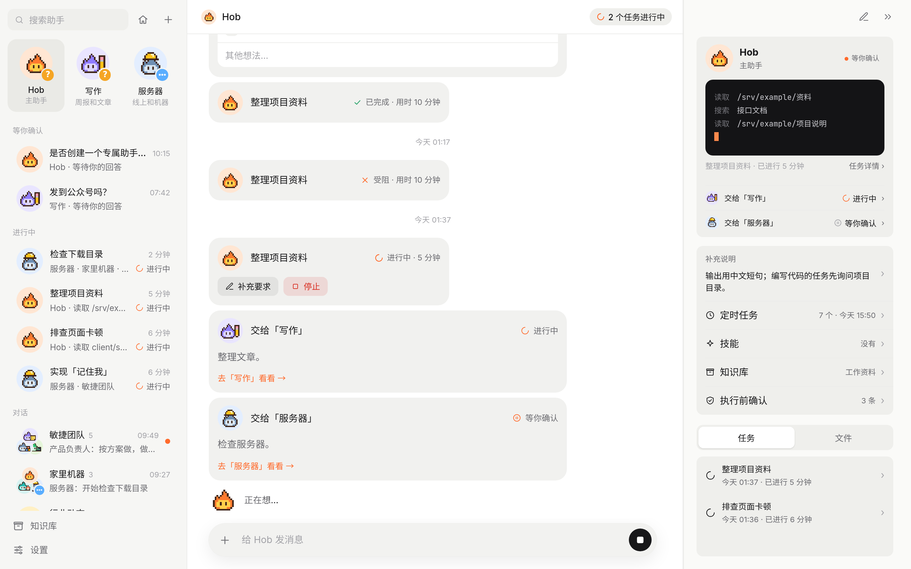

<div align="center">


# Hob

自己部署的私人助手。你交代事情，它当场办，或者交给后台任务去做；<br>
按你定的规则，该你拍板的才来问你。

[](https://www.npmjs.com/package/hob-bot)
[](https://github.com/FFatTiger/hob/pkgs/container/hob)

[](LICENSE)

[English](README.md) · [快速开始](#快速开始) · [部署](#部署) · [架构说明](docs/architecture.md)

</div>

> 界面目前只有中文。Hob 是单用户应用，跑在你自己的电脑或服务器上，用你自己的模型 API Key。



## 它怎么干活

- **你只和助手说话。** 每个助手有自己的职责、规则、技能和定时任务。小事它当场办；费时的活交给后台任务，任务卡上能看到实时过程，可以随时补充要求或叫停，做完结果回到对话里。
- **哪些事要先问你，由规则决定。** 全局规则和每个助手自己的规则，决定哪些操作要先等你确认、哪些直接照做。确认时可以顺手存成规则，下次同类的事不再问。
- **事情交给对的助手。** 主助手 Hob 会把归别的助手管的事转交过去，转交卡跟着进度走；同类的事反复出现时，它会提议给你建一个专门的助手。
- **定时任务有变化才叫醒助手。** 定时可以带一段检查脚本：到点先跑脚本，有新情况才让助手接手，没变化就不打扰你。
- **做过的活能变成技能。** 任务做完、做法值得留下时，助手可以让它把步骤写成技能，以后派活直接带上；每次修改都留一个版本。

## 助手团队

把几个助手拉进一个群，就是一个小团队：不点名时由群主接话，`@` 可以点名某个成员，每个成员在这个群里可以用不同的模型。群的定时任务由群主统筹，到点后由群主决定开话题、派给谁。

选了「软件开发」工作方式的群，较大的需求可以开一个话题、立一个事项：先澄清需求，再拆成子任务分给成员，在指定的工作目录里执行，最后逐条验收。新装时自带一个敏捷团队群，有产品、架构、开发、测试和发布五个成员。


## 手机上

在手机浏览器里打开就能用，也可以添加到主屏幕当应用。需要你确认、任务受阻或失败时会收到推送（需要 HTTPS）。


## 还能接上这些

- **模型**：Anthropic、OpenAI、Google、DeepSeek、OpenRouter 等内置服务商只填 API Key；OpenAI 或 Anthropic 兼容接口也能用。npm 和源码安装还可以直接用本机 Claude Code 的订阅。
- **知识库**：整理和预览文件，绑定给助手，引用能跳回原文；配了向量模型可以混合检索，PDF 也能建索引。
- **联网搜索**：SearXNG、Exa、Tavily、Brave、Serper、Jina、Firecrawl、Perplexity、You.com、Ollama。
- **MCP**：任务可以调用配置好的 MCP 服务，也能从 Claude Code、Cursor、pi 导入已有配置。
- **记忆**：存在本地，或者接入 [Lore](https://github.com/FFatTiger/lore)。
- **页面和图片**：助手可以把对比、调研做成网页在侧栏打开；配上 OpenAI 兼容的图像接口就能画图和改图。
- **云桌面**（可选）：每个助手一个浏览器，和它的任务共用登录状态；你可以在旁边看，也可以接管。
- **用量**：按模型、按助手统计请求数、token 和估算花费。

## 快速开始

需要 Node.js 22 或更高版本，以及至少一个模型服务商的 API Key。

```bash
npm install -g hob-bot
HOB_PASSWORD='设一个密码' hob
```

不想全局安装，可以直接运行 `HOB_PASSWORD='设一个密码' npx hob-bot`。也可以用 Docker，不需要 Node.js：

```bash
curl -O https://raw.githubusercontent.com/FFatTiger/hob/main/compose.yaml
echo "HOB_PASSWORD=设一个密码" > .env
docker compose up -d
```

打开 <http://127.0.0.1:30148>，用这个密码登录，然后：

1. **设置 → 服务商**：添加一个服务商，填好 API Key。
2. **设置 → 模型**：选对话和任务用的模型。
3. 给 Hob 发一条消息。收到回复，或者出现一张任务卡，就说明能用了。

密码只在第一次启动时需要，之后以哈希的形式存在数据目录里，改密码在 **设置 → 通用**。

## 部署

Hob 是单个 Node 进程，数据全在 `HOB_HOME`（默认 `~/.hob`）。

- **长期运行**：用任意进程管理器跑，比如 `pm2 start hob --name hob`（源码目录里先 `npm run build`，再 `pm2 start deploy/pm2.config.cjs`）。前面加一层带 TLS 的反向代理；推送通知和添加到主屏幕都需要 HTTPS。
- **Docker**：镜像是 `ghcr.io/ffattiger/hob`（amd64、arm64），数据在 `hob-data` 卷里；源码目录里加 `--build` 就用本地源码构建镜像。端口默认只绑本机，要局域网直连，把 `compose.yaml` 里的端口改成 `"30148:30148"`。任务和本地命令类的 MCP 服务都在容器里运行，镜像里有 git、curl、python3、ripgrep、fd、node 和 npx。要让任务处理宿主机上的项目，先建好 `workspace/` 目录（容器以 uid 1000 运行），再打开 `compose.yaml` 里 `./workspace:/workspace` 那行挂载。
- **云桌面**：`docker compose --profile desktop up -d` 同时启动 Hob 和云桌面，令牌自动对上。单独部署、反向代理和资源占用见[云桌面说明](desktop/README.md)。
- **Claude 订阅**：npm 或源码安装时，先在本机装好 Claude Code 并执行 `claude auth login`，再到 **设置 → 服务商** 启用 Claude 订阅。用量算在你的订阅额度里；Hob 不读取、不保存 Claude 凭证，Claude Code 自己的会话记录会写在 `~/.claude/projects/`。Docker 镜像不支持。
- **备份和升级**：备份 `HOB_HOME` 就保留了全部数据。从 1.5 之前的版本升级，会自动迁移数据目录并留一份完整备份，细节和回退方法见 [1.5.0 发版说明](https://github.com/FFatTiger/hob/releases/tag/v1.5.0)；Docker 里回退用 `docker compose run --rm hob node bin/hob.mjs layout --restore`（先停掉 Hob）。

## 配置

启动参数用环境变量（`HOB_HOME/system/config.json` 里也可以写 `host`、`port` 和初始 `password`，host 和 port 以环境变量为准），其余设置都在界面里，改完立即生效。

| 变量 | 默认值 | 作用 |
| --- | --- | --- |
| `HOB_HOME` | `~/.hob` | 数据目录 |
| `HOB_PORT` | `30148` | 端口 |
| `HOB_HOST` | `127.0.0.1` | 监听地址 |
| `HOB_PASSWORD` | — | 登录密码，只在第一次启动时需要 |
| `HOB_DESKTOP_URL`、`HOB_DESKTOP_TOKEN` 或 `HOB_DESKTOP_TOKEN_FILE` | — | 由部署指定云桌面，地址和令牌都有时覆盖界面里的设置 |
| `HOB_LOCAL_PI_DIR`、`HOB_LOCAL_LORE_HOME` | `~/.pi/agent`、`~/.lore` | 在设置里「从本机导入」时读取的目录 |

`HOB_HOME` 按归属分成 `system/`（配置、密钥、引擎、记忆）、`assistants/<id>/`（每个助手的对话、定时、任务和文件）、`cache/`（删了能重建）和 `archive/`。Hob 只用这个目录：本机已有的 pi、Lore 配置不会被自动读取，要用就在设置里主动导入。

## 开发

```bash
git clone https://github.com/FFatTiger/hob.git
cd hob
npm install
npm run build && npm start   # 从源码运行，等同于 hob 命令
npm run dev:server   # 后端，改动自动重载，端口 30148
npm run dev:web      # 前端，/api 代理到 30148
npm test
npm run typecheck
```

前端地址加上 `?mock=1` 会改用浏览器里的模拟后端，不需要模型和服务端，README 里的截图就是这样拍的（`scripts/readme-screenshots.mjs`）。

技术栈：Node 22 + TypeScript，Hono + SSE，Vite + React，CSS 全部手写；智能体引擎是进程内运行的 [pi](https://github.com/earendil-works/pi) SDK。设计、数据布局和工具列表见 [docs/architecture.md](docs/architecture.md)。

## 许可证

[MIT](LICENSE)。内置的 noVNC 客户端使用 MPL-2.0 许可证，Playwright 使用 Apache-2.0。

本开源项目已链接并认可 [LINUX DO 社区](https://linux.do)。
