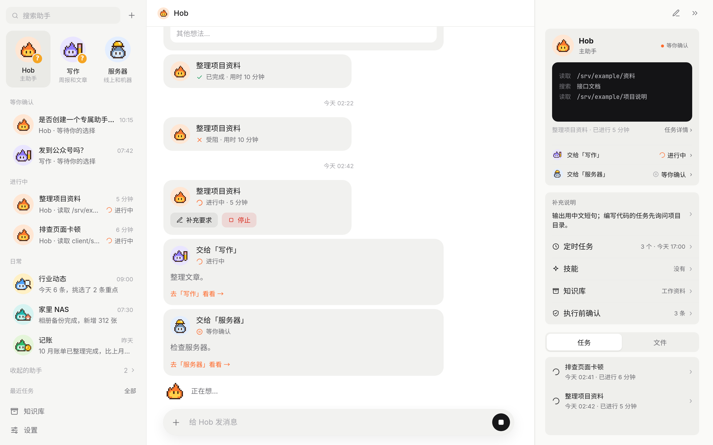
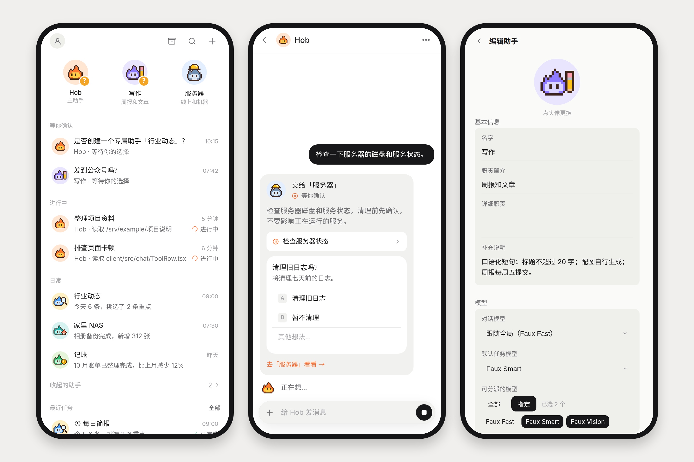

# Hob

Hob 是一个自己部署、真正动手处理事务的私人助手。你只和 Hob 说话：小事它当场处理，大活交给后台任务。

[English](README.md) · [架构说明](docs/architecture.md) · MIT 许可证

> 目前界面只有中文。Hob 是单用户应用，运行在你自己的电脑或服务器上。



## 怎么运作

你只和助手说话，不直接和任务交互。助手小事当场处理，大活交给任务；任务只向助手交 Markdown 结果和文件，有问题也只问助手。助手决定给你看什么、什么时候问你；全局规则和每个助手自己的规则决定哪些事情要先征求你的确认。

## 功能

### 助手、任务和定时

每个助手有自己的对话、职责、规则、技能、定时任务和工作日志。同类工作反复出现时，Hob 会提议创建专门的助手；向其他助手转交时，对话中的转交卡会跟踪状态、带上你的原话，你也可以在接收助手的对话中接手。

任务可查看过程、停止或续做，每轮记录分别保留；超出预计用时后，助手会收到督办提醒。定时任务把任务卡和结果发到对应的对话里。定时任务可以只在某个时间跑一次，也可以带一个检查脚本：到点先跑脚本，有变化才叫起助手或直接给你留一条提醒，还可以设成触发一次就停。助手输出时对话会跟着往下滚，截图可以直接粘贴，文件可以直接拖进窗口。

手机上可查看助手列表、对话和档案，支持滑动回复和长按操作。助手需要你确认，或任务受阻、失败时，可以收到推送通知。



### 技能

技能归助手管：派活时由助手决定给任务哪几份，定时任务可以绑定一份。任务做完、结果值得留下时，助手让做这件事的原任务在自己的会话里把它写成技能，写之前把命令和脚本真跑一遍。管同一类事的技能会合成一份，旧的归档；任务照着技能做时发现哪一步过时，助手会让它改对。

### 规则

全局规则对所有助手和任务生效，每个助手也可以有自己的规则。规则分为执行前确认和一律照做；确认时可以选择以后允许同类操作，保存为规则。

### 页面和知识库

助手可以把方案比较、调研等内容做成页面，在侧栏打开。知识库支持整理、搜索和预览文件，绑定到助手并从引用跳到原文；配置向量模型后可混合检索，也支持为 PDF 文字建立索引。

### 云桌面和工具

可选的云桌面为每个助手提供与任务共用的屏幕和浏览器，也可允许指定助手使用公共屏幕。助手可以自己操作浏览器并在对话中发送截图，你可以观看或接管。

助手和任务可以使用 SearXNG、Exa、Tavily、Brave、Serper、Jina、Firecrawl、Perplexity、You.com、Ollama 的联网搜索。任务可以调用配置好的 MCP 服务，也可以从 Claude Code、Cursor 和 pi 导入已有配置。记忆可保存在本地或接入 [Lore](https://github.com/FFatTiger/lore)；图像生成使用 OpenAI 兼容接口。npm 或源码安装也可以使用本机已有的 Claude Code 订阅登录。

### 消耗

设置 → 消耗 把已有的对话和任务统计起来，显示今天、近 7 天、近 30 天和全部的请求数、token 和估算花费，附最近一年的热力图，以及按模型、按助手的明细。单价默认取自 models.dev，也可以按模型自己改。

### 浅色和深色

Hob 支持浅色、深色，以及跟随系统设置。

## 快速开始

需要 Node.js 22 或更高版本，以及至少一个模型服务商的 API Key。

```bash
npm install -g hob-bot
HOB_PASSWORD='设一个密码' hob
```

不想全局安装，也可以直接运行一次：`HOB_PASSWORD='设一个密码' npx hob-bot`。

也可以用 Docker（不需要 Node.js，详见 [Docker](#docker)）：

```bash
curl -O https://raw.githubusercontent.com/FFatTiger/hob/main/compose.yaml
echo "HOB_PASSWORD=设一个密码" > .env
docker compose up -d
```

打开 <http://127.0.0.1:30148>，用这个密码登录，然后：

1. 到 **设置 → 服务商** 添加服务商。内置服务商（Anthropic、OpenAI、Google、DeepSeek、OpenRouter 等）只需填 API Key；OpenAI 或 Anthropic 兼容接口也可以用。
2. 到 **设置 → 模型** 选好对话和任务使用的模型。
3. 给 Hob 发一条消息。收到回复，或者出现一张任务卡，就说明配置好了。

首次启动时密码会转成哈希写进 `~/.hob/system/config.json`，之后启动不用再带 `HOB_PASSWORD`。改密码在 **设置 → 通用**。

## 配置

启动项用环境变量设置。服务商、模型、记忆、搜索、技能、通知等其余设置都在界面里，改完立即生效。

| 变量 | 默认值 | 作用 |
| --- | --- | --- |
| `HOB_HOME` | `~/.hob` | 数据目录 |
| `HOB_PORT` | `30148` | HTTP 端口 |
| `HOB_HOST` | `127.0.0.1` | 监听地址 |
| `HOB_PASSWORD` | — | 登录密码；首次启动必填，除非 `config.json` 里已写了 `password` |
| `HOB_DESKTOP_URL` | — | 部署配置中的云桌面服务地址 |
| `HOB_DESKTOP_TOKEN` / `HOB_DESKTOP_TOKEN_FILE` | — | 云桌面令牌或令牌文件路径；地址和非空令牌同时存在时覆盖界面设置 |
| `HOB_LOCAL_PI_DIR` / `HOB_LOCAL_LORE_HOME` | `~/.pi/agent` / `~/.lore` | 主动从本机导入时使用的来源目录；未设置时使用原来的 `PI_CODING_AGENT_DIR` / `LORE_HOME` |

`config.json` 也可设置 `host`、`port` 和初始 `password`；host 和 port 以环境变量优先。Hob 将引擎和记忆目录隔离到 `HOB_HOME`，并从运行环境移除继承的模型及 Lore 凭据。

对话、任务、记忆、技能、Key 和引擎数据都在 `HOB_HOME` 里，按归属放：`system/`（配置、密钥、引擎、Lore、记忆）、`cache/`（删了能重建）、`assistants/<id>/`（每个助手的档案、对话、定时、任务和文件）、`archive/`。想沿用本机已有的服务商或 Lore 连接，可以在设置里主动导入。备份 `HOB_HOME` 即可保留 Hob 的数据。

**数据目录迁移。** 旧版本把东西平铺在 `HOB_HOME` 根上（`jobs/`、`pages/`、`images/` …… 再加几个 json）。新版本启动时会自动迁移，并且发生在动引擎之前：先看空间够不够，把整个目录完整复制到 `HOB_HOME/backup-v1-<时间>/` 并逐个文件核对（保留权限和符号链接），再搬文件，最后才写 `system/moves.json`（旧路径 → 新路径）和 `layout.json`。中途断掉的话，下次启动先从备份恢复再重跑。备份**不会自动删**：确认新布局没问题后自己删 `backup-v1-*`（里面有整份密钥）。两条命令备用：

```
npm run layout -- --dry-run   # 只打印迁移计划，什么都不动
npm run layout -- --restore   # 从备份恢复成老布局
# npm 安装的：hob layout --dry-run / hob layout --restore
# Docker（先停掉 Hob）：docker compose run --rm hob node bin/hob.mjs layout --restore
```

降级要先恢复成老布局：旧版本不认识新布局，不能让新旧版本同时写同一份数据。

**Claude 订阅：** npm 或源码安装时，先安装 Claude Code 并在本机执行 `claude auth login`，然后在 **设置 → 服务商** 启用 Claude 订阅、选择 Pro 或 Max，再到 **设置 → 模型** 选择模型。用量计入 Claude 订阅额度，与 Claude Code 共用。Docker 镜像不支持此功能。Hob 不读取、复制、保存或转发 Claude 凭证，由官方 Claude Code 程序使用已有登录。Claude Code 会在 `~/.claude/projects/` 保存自己的会话记录，此目录不属于 `HOB_HOME`。

## 部署

Hob 是单个 Node 进程。用任意进程管理器运行，前面加一层带 TLS 的反向代理即可。推送通知和安装成应用都需要 HTTPS。用 PM2 的话：

```bash
pm2 start hob --name hob           # npm install -g hob-bot 之后
pm2 start deploy/pm2.config.cjs   # 或者在源码目录里：进程名 hob，端口 30148，数据在 ~/.hob
```

### Docker

```bash
curl -O https://raw.githubusercontent.com/FFatTiger/hob/main/compose.yaml
echo "HOB_PASSWORD=change-me" > .env   # 只有首次启动需要
docker compose up -d
```

这会拉取 `ghcr.io/ffattiger/hob`（amd64 和 arm64，每次发版自动构建）。在源码目录里用 `docker compose up -d --build` 则在本地构建镜像。打开 `http://127.0.0.1:30148`。数据在 `hob-data` 卷里（容器内 `/data`），密码以哈希存在这里，之后可以删掉 `.env`。端口默认只绑本机，方便接反向代理；要局域网直连，把 `compose.yaml` 里的端口改成 `"30148:30148"`。

任务在容器里运行（装好了 git、curl、python3、ripgrep 和 fd）。本地命令类的 MCP 服务也在容器里运行，命令要在镜像里存在（镜像里有 node 和 npx，没有 uvx 等其他语言的包管理器）。要让任务处理宿主机上的项目，先建好 `workspace/` 目录（容器以 uid 1000 运行），取消注释 `./workspace:/workspace` 挂载，把任务的工作目录设在这里。

### 云桌面

云桌面是可选的独立 Linux 容器。每个助手有独立屏幕和浏览器登录状态，首次使用时启动。助手可以直接操作浏览器，和任务共用登录状态；任务正在使用浏览器时，助手会收到等待或协调的提示。浏览器和桌面截图可以发到对话中。设置 → 云桌面中可以允许指定助手使用公共屏幕，默认不允许任何助手使用；公共屏幕同一时间只供一个任务使用，其他任务最多等待 10 分钟。没有观看者、浏览器连接和操作的屏幕默认空闲 30 分钟后回收，浏览器登录状态会保留。在根目录 `compose.yaml` 同目录的 `.env` 设置 `HOB_PASSWORD` 后，一条命令启动两项服务：

```bash
docker compose --profile desktop up -d
```

桌面端口不会映射到宿主机；Hob 从共享卷读取自动生成的令牌，设置 → 云桌面会显示「由部署配置」。不加 profile 时 Hob 单独运行，云桌面显示未配置。

也可用 [`desktop/compose.yaml`](desktop/compose.yaml) 或[桌面部署说明](desktop/README.md)中的 `docker run` 单独部署，再在 Hob 设置中填写地址和令牌。没有启动 desktop profile、共享令牌文件不存在或为空时，Hob 使用设置里填写的云桌面；令牌文件出现后，以 Compose 部署为准。登录 Hob 的人都可以观看和接管单块屏幕，网站登录由人自己完成，不让助手代登。受 Google 限制，开启远程调试的浏览器目前无法登录 Google 账号。桌面数据卷里的浏览器 Cookie 是敏感信息；令牌通过 HTTP 明文传输，跨机器连接请使用可信内网或 HTTPS，不要映射 VNC / CDP 端口。

桌面容器的时区和语言由 `TZ`（IANA 时区名）和 `DESKTOP_LANG`（BCP 47 语言标签，如 `en-US`）决定，写在同一目录的 `.env` 里，默认 `UTC` 和 `zh-CN`。它们管桌面里所有程序的界面语言、浏览器界面语言，以及浏览器发给网站的 `Accept-Language` 和 `navigator.languages`；分辨率用 `DESKTOP_RESOLUTION`（默认 `1280x800`）。网站会对照出口 IP 所在地、时区和语言，出口不在国内时把这几项一起改，不然更容易被风控拦。已有的浏览器 profile 也按部署配置，在浏览器设置里自己改过的语言会被盖掉。

云桌面 v2 在一台 amd64 机器上的实测：镜像占用 2.03 GB；不开屏幕时内存 23.5 MiB，一块 Chrome 屏幕打开 example.com 时 354.9 MiB，三块 Chrome 屏幕打开新标签页时 1017 MiB。页面负载不同，实际占用因机器和页面而异。

前面有反向代理时，桌面画面需要 `/api/desktop/vnc` 支持 WebSocket 升级。nginx 示例：

```nginx
location = /api/desktop/vnc {
    proxy_pass http://127.0.0.1:30148;
    proxy_http_version 1.1;
    proxy_set_header Host $http_host;
    proxy_set_header Upgrade $http_upgrade;
    proxy_set_header Connection "upgrade";
    proxy_read_timeout 3600s;
}
```

内置 noVNC 客户端使用 MPL-2.0 许可证，Playwright 使用 Apache-2.0。

## 开发

```bash
git clone https://github.com/FFatTiger/hob.git
cd hob
npm install
npm run build
npm start            # 从源码运行，等同于 hob 命令
npm run dev:server   # 后端，改动自动重载，端口 30148
npm run dev:web      # Vite 开发服务器，/api 代理到 30148
npm test             # vitest
npm run typecheck
```

开发地址加上 `?mock=1`，界面会使用浏览器内的模拟后端，不需要模型和服务端。上面的截图就是这样拍的。

技术栈：Node 22 + TypeScript，Hono + SSE，Vite + React，CSS 全部手写。智能体引擎是进程内运行的 [pi](https://github.com/earendil-works/pi) SDK。设计、数据布局和工具列表见 [docs/architecture.md](docs/architecture.md)。

## 许可证

[MIT](LICENSE)

## 社区

本开源项目已链接并认可 [LINUX DO 社区](https://linux.do)。
